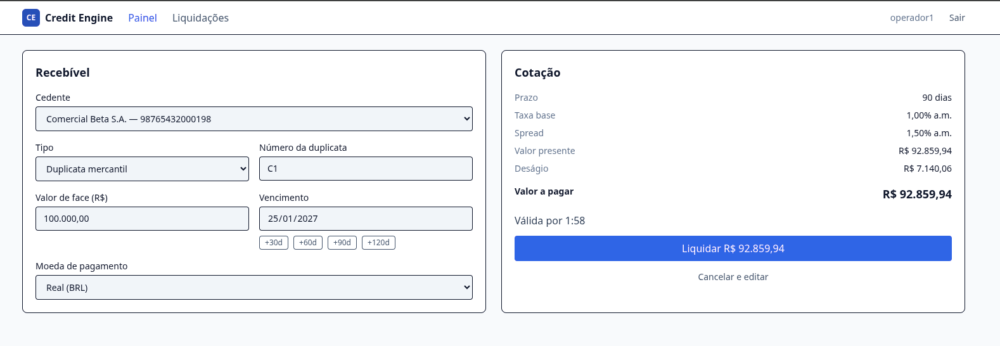
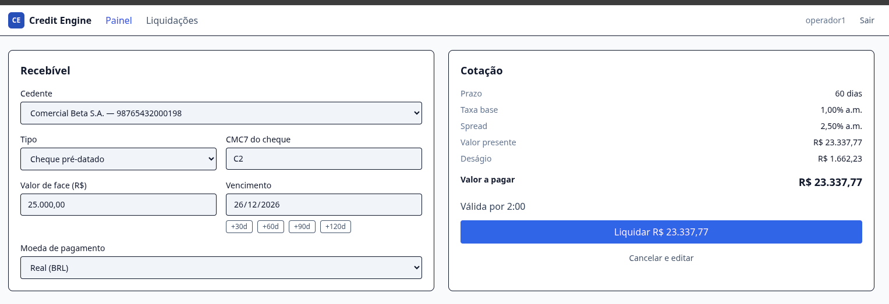
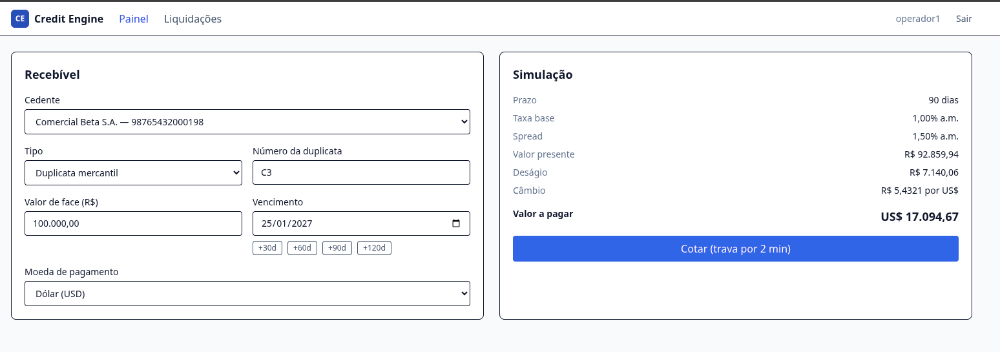
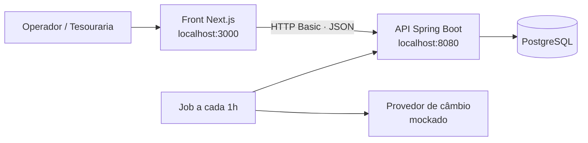
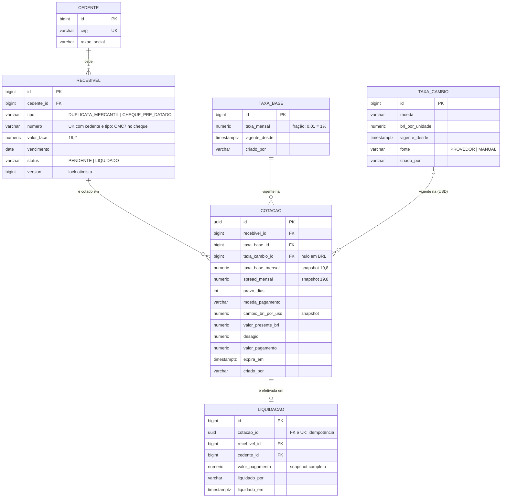

# SRM Credit Engine

Plataforma de precificação e liquidação de recebíveis (duplicatas e cheques) com pagamento em **BRL ou USD**, precisão decimal ao centavo e liquidação idempotente e auditável.

| Documento | Conteúdo |
|---|---|
| [`SPEC.md`](SPEC.md) | Premissas, precisão numérica, critérios de aceite e perguntas ao negócio (escrito antes do código) |
| [`DECISIONS.md`](DECISIONS.md) | O que cortei ou simplifiquei, e onde a entrega diverge do SPEC |
| [`REVIEW.md`](REVIEW.md) | Code review do endpoint do Anexo A, por severidade |
| [`AI_USAGE.md`](AI_USAGE.md) | Como usei IA, os erros que ela cometeu e como detectei |

## Como rodar

**Pré-requisito:** Docker com Docker Compose.

```bash
cp .env.example .env        # defina as senhas (qualquer valor serve localmente)
docker compose up -d --build
```

O primeiro build leva alguns minutos (dependências do Maven e do npm). Depois:

| O quê | Endereço |
|---|---|
| Aplicação | http://localhost:3000 |
| Swagger (documentação e teste da API) | http://localhost:8080/swagger-ui.html |
| Saúde da API | http://localhost:8080/actuator/health |
| PostgreSQL (para inspeção) | `localhost:5433`, banco `creditengine` |

**Usuários** (senhas definidas no `.env`):

| Usuário | Perfil | Acesso |
|---|---|---|
| `operador1`, `operador2` | `OPERADOR` | Painel (simular, cotar, liquidar) e extrato de liquidações |
| `tesouraria1` | `TESOURARIA` | Taxa base e câmbio |

O banco sobe com 3 cedentes, a taxa base de 1% a.m. e, logo na subida, o câmbio do provedor mockado (R$ 5,4321 por US$, o câmbio do golden case C3).

**Roteiro rápido:** entre como `operador1`, escolha um cedente, informe um número de título e o valor `100.000,00`, e clique em **+90d** no vencimento. A simulação aparece sozinha com **R$ 92.859,94**. Clique em **Cotar** (a cotação fica travada por 2 minutos), depois em **Liquidar**, e veja a operação em **Liquidações**.

Para parar: `docker compose down`. Para apagar também os dados: `docker compose down -v`.

## Golden cases

Os três casos de aferição do enunciado são verificados de duas formas:

1. **No motor**, pelo teste `GoldenCasesTest`, executado no CI a cada PR.
2. **Ponta a ponta**, pela tela, passando por banco, API, JSON e formatação:

| Caso | Entrada | Esperado |
|---|---|---|
| C1 | Duplicata, R$ 100.000,00, 90 dias, BRL | R$ 92.859,94 · deságio R$ 7.140,06 |
| C2 | Cheque, R$ 25.000,00, 60 dias, BRL | R$ 23.337,77 · deságio R$ 1.662,23 |
| C3 | Duplicata, R$ 100.000,00, 90 dias, USD a 5,4321 | US$ 17.094,67 · deságio R$ 7.140,06 |

**C1**



**C2**



**C3**



Com a premissa de prazo do SPEC (dias corridos ÷ 30), 90 e 60 dias são exatamente os 3 e 2 meses dos golden cases.

## Stack e por quê

| Camada | Escolha | Motivo |
|---|---|---|
| Linguagem | **Java 17** | Tipagem forte e `BigDecimal` nativo; mínimo exigido pelo Spring Boot 4 |
| Framework | **Spring Boot 4.0.9** | Maduro para sistemas financeiros (transação, segurança, validação). Não usei a 4.1 porque o MyBatis ainda não a suporta |
| Banco | **PostgreSQL 17** + Flyway | `NUMERIC` exato, `timestamptz`, constraints e trigger de imutabilidade; schema versionado em migrations |
| Persistência | **JPA** nas escritas, **MyBatis** no extrato | Lock otimista e entidades onde há regra de escrita; SQL explícito onde há consulta analítica com filtros dinâmicos |
| Precisão | `BigDecimal` + `MathContext.DECIMAL128` + big-math | Nada de `double`; potência fracionária com precisão arbitrária |
| Front | **Next.js 16** + TypeScript + Tailwind | Tipagem também no front; roteamento por pastas; todas as telas rodam no navegador |
| Testes | JUnit + AssertJ + **Testcontainers**; Vitest | PostgreSQL real nos testes de integração (trigger, concorrência e transação abortada não funcionam igual em H2) |
| Entrega | Docker Compose, GitHub Actions | Um comando para subir tudo; testes, lint e build a cada PR |

## Arquitetura



- **Um monólito em camadas**, organizado **por funcionalidade**: `precificacao`, `taxas`, `recebivel`, `cotacao`, `liquidacao`, `extrato`, `usuario`, mais `comum` (erros) e `config` (segurança, OpenAPI, traceId). Dentro de cada pacote: controller → service → repository (JPA) ou mapper (MyBatis).
- **Motor de precificação com Strategy:** cada tipo de recebível é uma classe (`DuplicataMercantil`, `ChequePreDatado`) com o seu spread. Um tipo novo é uma classe nova com `@Component`; o motor a recebe sozinho.
- **O provedor de câmbio fica fora do caminho crítico.** Ele só alimenta o cadastro de câmbio (pelo job ou pelo botão da tesouraria, com timeout de 2 s e retry). Simulação, cotação e liquidação só leem o cadastro: se o provedor cair, elas continuam funcionando com a taxa vigente por até 24h.

### Fluxo de uma operação

1. **Simulação** (`POST /simulacoes`): calcula sem gravar, chamada pelo painel 300 ms depois que o usuário para de digitar.
2. **Cotação** (`POST /cotacoes`): cadastra o recebível se ainda não existir e congela taxa base, spread, câmbio, prazo e valores por **2 minutos**.
3. **Liquidação** (`PUT /cotacoes/{id}/liquidacao`): efetiva **exatamente os valores cotados**.
   - 1ª chamada → `201`; repetição → `200` com a mesma liquidação (idempotente pela `UNIQUE (cotacao_id)`).
   - Duas cotações do mesmo título liquidadas ao mesmo tempo → uma vence, a outra recebe `409` (optimistic locking com `@Version`).
   - Cotação expirada → `422`. Liquidação de outro operador → `403`.
   - INSERT da liquidação e UPDATE do recebível na mesma transação; uma trigger impede UPDATE/DELETE na liquidação.

## Modelo de dados



Pontos de desenho:

- **Taxas e câmbio têm vigência:** uma nova taxa é um novo registro, nunca um UPDATE.
- **A cotação guarda referência e cópia das taxas usadas** (snapshot), e a liquidação copia tudo da cotação: valores, taxas, câmbio, prazo, usuário e horário. Ela é **autossuficiente para auditoria**, mesmo que as taxas mudem depois.
- **Dinheiro em `NUMERIC(19,2)`, taxas e câmbio em `NUMERIC(19,8)`**; horários em `timestamptz` (UTC).
- O extrato tem o índice `(cedente_id, moeda_pagamento, liquidado_em DESC)` para o filtro completo.

## Precisão numérica

- `BigDecimal` construído a partir de `String`, cálculos com `DECIMAL128` (34 dígitos), **HALF_EVEN com 2 casas só no resultado final**.
- Em pagamento USD, o valor presente em BRL é arredondado **antes** de converter (regra do golden case C3).
- Valores trafegam no JSON como **string** (`"92859.94"`): o `number` do JavaScript é ponto flutuante binário. O front nunca calcula; ele só formata, também a partir da string.

## API

Documentação completa no Swagger (`/swagger-ui.html`). Erros seguem **Problem Details (RFC 9457)**, com um `codigo` estável (ex.: `COTACAO_EXPIRADA`) e, em `500`, um `traceId`.

| Método e rota | Perfil | Resposta |
|---|---|---|
| `POST /simulacoes` | OPERADOR | `200` (não grava) |
| `POST /cotacoes` | OPERADOR | `201` |
| `PUT /cotacoes/{id}/liquidacao` | OPERADOR (criador da cotação) | `201` nova · `200` repetição |
| `GET /liquidacoes` | OPERADOR | `200` paginado (`tamanho` ≤ 100) |
| `GET /cedentes` | OPERADOR | `200` |
| `GET /taxas/vigentes` | OPERADOR, TESOURARIA | `200` |
| `POST /taxas/base`, `POST /taxas/cambio`, `POST /taxas/cambio/atualizar` | TESOURARIA | `201` (atualizar: `503` se o provedor cair) |
| `GET /usuarios/eu` | qualquer autenticado | `200` usuário e perfis |

## Testes

```bash
cd backend && ./mvnw test     # 54 testes; precisa de Docker (Testcontainers)
cd frontend && npm test       # 19 testes (Vitest)
```

| O quê | Exemplos |
|---|---|
| Motor | Golden cases C1–C3; bordas (45 dias, empate do HALF_EVEN, VP nunca maior que a face) |
| Idempotência e concorrência | 10 liquidações simultâneas da mesma cotação = 1 registro; 2 cotações do mesmo título = 1 sucesso + 1 `409`; rollback completo da perdedora |
| Tempo | Expiração da cotação e câmbio com mais de 24h com `Clock` controlado |
| Auditoria | UPDATE/DELETE na liquidação rejeitados pelo banco (via JDBC) |
| API e segurança | Matriz de perfis (401/403), validação (400), SQL injection no filtro (400), preflight de CORS |
| Extrato | Filtros, fronteira de fuso (23:30 em São Paulo = dia seguinte em UTC), paginação; build falha se houver `${` num mapper |
| Front | Máscara e conversão de valores sem ponto flutuante, percentual → fração, contagem regressiva, soma de dias |

O **CI** (GitHub Actions) roda tudo isso, mais o lint e o build do front, a cada PR e push na `main`.

## Observabilidade

- **`traceId` por requisição:** aparece no header `X-Trace-Id`, em todas as linhas de log da requisição e no corpo dos erros `500`.
- **Log estruturado em JSON** (formato ECS) no container.
- **Métricas** em `/actuator/metrics` (exige login):
  - `liquidacoes` por `moeda` e `resultado` (`nova`, `existente`, `expirada`, `conflito`);
  - `precificacao.motor` com p50/p95/p99.

```bash
curl -u operador1:<senha> localhost:8080/actuator/metrics/liquidacoes
docker compose logs backend | grep "Liquidação registrada"
```

## Git

- **GitHub Flow:** `main` estável, uma branch por funcionalidade e PR para cada uma, com a descrição do **porquê**. Para um desenvolvedor só e uma entrega curta, Git Flow seria cerimônia sem ganho.
- **Conventional Commits** (`feat`, `fix`, `test`, `docs`, `refactor`, `build`, `ci`), com descrição em português.
- **Merge commit**, e não squash, para preservar os commits atômicos de cada PR.
- O SPEC foi o primeiro PR, antes de qualquer código.
