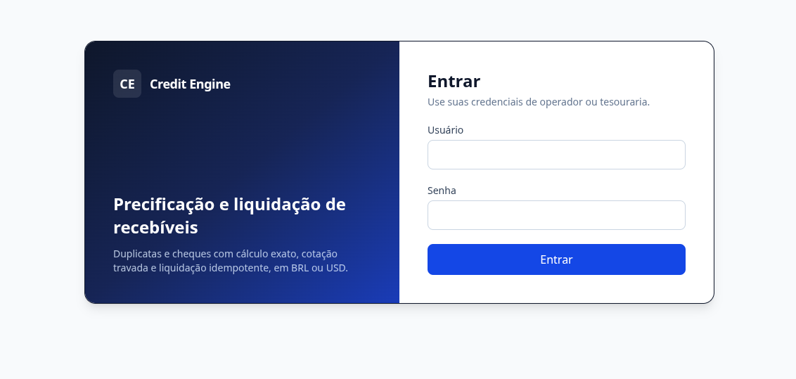
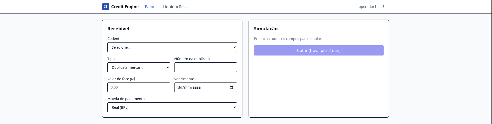
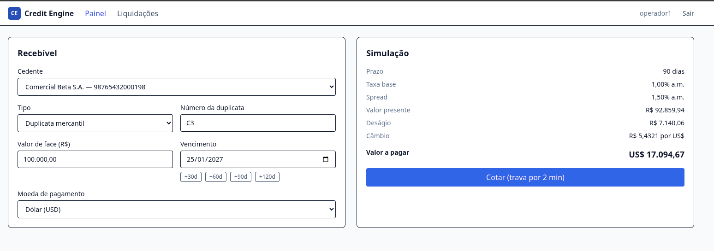
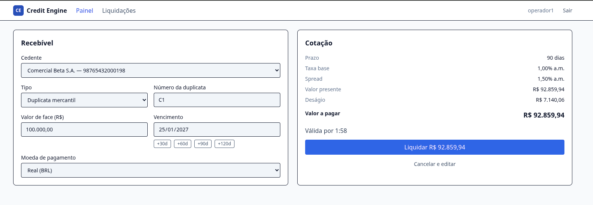
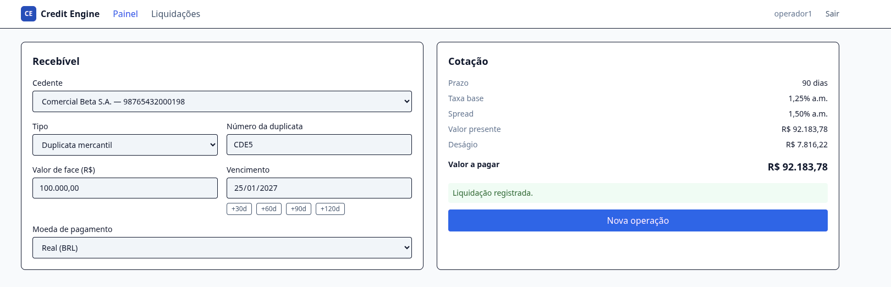
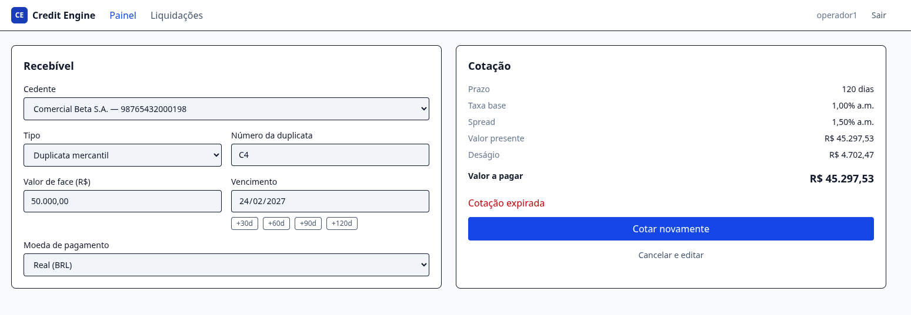
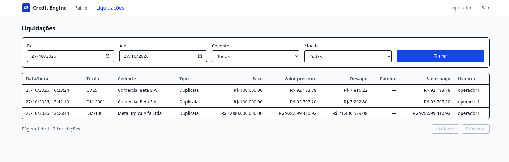
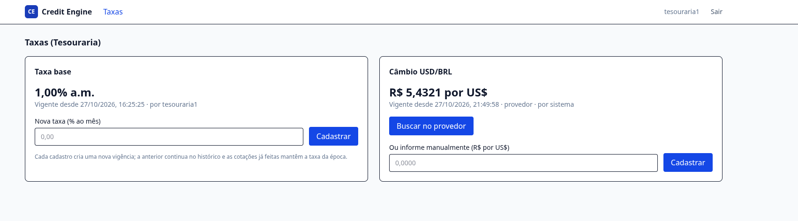

# Manual de utilização — SRM Credit Engine

Este manual explica como usar o sistema no dia a dia. Para instalar e subir a aplicação, veja o [`README.md`](../README.md).

## 1. Perfis de acesso

| Perfil | Usuários | O que faz |
|---|---|---|
| **Operador** | `operador1`, `operador2` | Simula, cota e liquida recebíveis; consulta as liquidações |
| **Tesouraria** | `tesouraria1` | Mantém a taxa base e o câmbio |

Cada perfil vê no menu só as telas que pode usar.

## 2. Acesso ao sistema

1. Abra **http://localhost:3000**.

   

2. Informe usuário e senha e clique em **Entrar**.
   - Senha errada: aparece *"Usuário ou senha inválidos"* e o sistema não deixa entrar.
3. O operador vai direto para o **Painel**; a tesouraria, para **Taxas**.

Sobre a sessão:

- Por segurança, a senha fica **só na memória do navegador**. Recarregar a página (F5) ou fechar a aba pede o login de novo.
- Depois de **15 minutos sem usar** o sistema, a sessão é encerrada sozinha.
- Para sair, clique em **Sair**, no canto superior direito.

## 3. Painel do operador

O painel é onde uma operação acontece, do cálculo à liquidação.

### 3.1 Preencher o recebível

| Campo | Como preencher |
|---|---|
| **Cedente** | A empresa que está cedendo o título |
| **Tipo** | Duplicata mercantil ou cheque pré-datado. Cada tipo tem o seu spread (1,5% a.m. e 2,5% a.m.) |
| **Número da duplicata** / **CMC7 do cheque** | O número impresso no título. No cheque, use o CMC7 (a linha numérica de baixo do cheque), que identifica banco, agência, conta e número |
| **Valor de face** | Digite só números: eles entram pelos centavos, como em app de banco (`10000000` vira `100.000,00`). Limite: R$ 1 bilhão |
| **Vencimento** | A data impressa no título. Os botões **+30d**, **+60d**, **+90d** e **+120d** preenchem a data a partir de hoje, úteis para simular |
| **Moeda de pagamento** | Real (BRL) ou Dólar (USD) |

O mesmo número de título pode existir em cedentes diferentes; o sistema identifica o título pela combinação **cedente + tipo + número**.

### 3.2 Simulação

Com todos os campos preenchidos, a **simulação aparece sozinha** um instante depois que você para de digitar. Não há botão "calcular". A cada alteração, o valor é recalculado.

O quadro mostra:

- **Prazo**, em dias corridos até o vencimento;
- **Taxa base** e **spread** usados, em % ao mês;
- **Valor presente** e **deságio**, sempre em reais;
- **Câmbio**, quando o pagamento é em dólar;
- **Valor a pagar**, na moeda escolhida.

Se o câmbio tiver mais de 24 horas, aparece um aviso: a simulação funciona, mas a cotação em dólar só será aceita depois que a Tesouraria atualizar a taxa.

A simulação **não grava nada**. Ela só mostra quanto seria pago.

### 3.3 Cotar

Clique em **Cotar (trava por 2 min)**. A cotação **congela** a taxa base, o spread, o câmbio, o prazo e os valores por **2 minutos**, e o formulário fica bloqueado.

- A contagem **"Válida por"** mostra o tempo restante.
- **Cancelar e editar** descarta a cotação e libera o formulário.
- Se o título já tiver sido cadastrado antes com outro valor ou vencimento, a cotação é recusada. Confira os dados do documento.

### 3.4 Liquidar

Dentro dos 2 minutos, clique em **Liquidar**. O botão mostra o valor exato que será pago.

- A liquidação usa **exatamente os valores da cotação**, mesmo que a Tesouraria mude uma taxa nesse meio-tempo.
- Clicar duas vezes, ou repetir a operação por queda de conexão, **não liquida duas vezes**: o sistema avisa *"Esta cotação já estava liquidada"*.
- Só quem criou a cotação pode liquidá-la.
- Uma liquidação **não pode ser alterada nem excluída**. Um estorno, quando necessário, é uma nova operação.

Clique em **Nova operação** para começar outra.

### 3.5 Quando a cotação expira

Se os 2 minutos passarem, o painel mostra **"Cotação expirada"** e o botão vira **Cotar novamente**, que gera uma nova cotação com as taxas vigentes naquele momento.

## 4. Liquidações (extrato)

A tela **Liquidações** lista as operações efetivadas.

1. Ao abrir, a tela já mostra as liquidações **de hoje**.
2. Ajuste o **período** (De / Até), o **cedente** e a **moeda**, e clique em **Filtrar**.
3. Use **Anterior** e **Próxima** para navegar entre as páginas (20 liquidações por página).

As datas seguem o horário de Brasília. Cada linha mostra o título, o cedente, os valores (face, valor presente, deságio), o câmbio usado (em pagamentos em dólar), o valor pago e o operador que liquidou.

## 5. Taxas (Tesouraria)

A tela **Taxas** mostra a taxa base e o câmbio **vigentes**, com a data e o responsável por cada um.

### 5.1 Taxa base

Digite a nova taxa **em percentual ao mês** (`125` vira `1,25`) e clique em **Cadastrar**.

- A nova taxa vale **a partir daquele momento**. Cotações já feitas continuam com a taxa da época.
- O limite é de 20% ao mês, como proteção contra erro de digitação.

### 5.2 Câmbio

- **Buscar no provedor:** consulta a cotação do dólar no provedor externo. Se o provedor estiver fora do ar, aparece um aviso de indisponibilidade, e o câmbio vigente continua valendo.
- **Informar manualmente:** digite o valor em reais por dólar (`54321` vira `5,4321`) e clique em **Cadastrar**. É a alternativa quando o provedor não responde.

O sistema também busca o câmbio no provedor automaticamente **a cada hora**. Um câmbio com mais de 24 horas bloqueia novas cotações em dólar até ser atualizado.

## 6. Mensagens mais comuns

| Mensagem | O que significa | O que fazer |
|---|---|---|
| Usuário ou senha inválidos | Credenciais erradas | Conferir usuário e senha |
| A cotação expirou. Cote novamente. | Passaram-se os 2 minutos | Clicar em **Cotar novamente** |
| A taxa de câmbio vigente tem mais de 24h | Câmbio desatualizado | Pedir à Tesouraria para atualizar o câmbio |
| O título … já foi liquidado | O título já foi efetivado antes | Conferir o número; um título só é cedido uma vez |
| O título … já está cadastrado com outro valor ou vencimento | O número já existe para esse cedente com outros dados | Conferir os dados do documento |
| A cotação … pertence a outro operador | A cotação foi criada por outro usuário | Cotar novamente com o seu usuário |
| Seu perfil não tem acesso a esta tela | A tela é de outro perfil | Entrar com o usuário adequado |
| Não foi possível conectar ao servidor | A API não está respondendo | Verificar se a aplicação está no ar (`docker compose ps`) |
